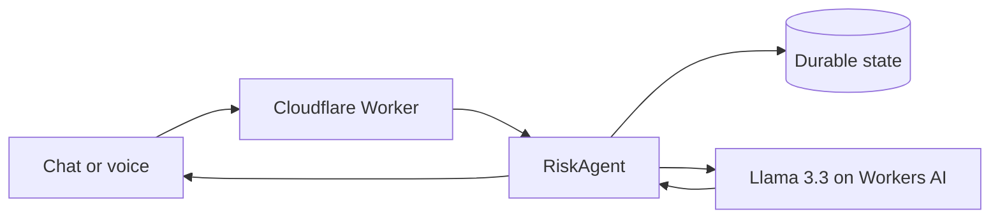

# Signal — TPM Command Center

Signal is an AI-powered technical program management copilot built on Cloudflare. It converts ambiguous infrastructure-program updates into executive-ready risk analysis, decisions, accountable next steps, governance cadences, and success metrics.

## Assignment coverage

| Requirement | Implementation |
|---|---|
| LLM | Llama 3.3 70B Instruct on Workers AI |
| Workflow / coordination | Cloudflare Agent coordinates context, inference, validation, and session routing |
| User input | Responsive chat plus browser speech-to-text voice input |
| Memory / state | Agents SDK state in a SQLite-backed Durable Object |

## Architecture



Each browser creates an opaque session identifier. The Worker routes requests to a named `RiskAgent`. The Agent stores the latest 18 messages, sends the relevant conversation to Llama 3.3, and persists the response for later turns.

## Run locally

Prerequisites: Node.js 20+ and a Cloudflare account.

```bash
npm install
npx wrangler login
npm run dev
```

Open `http://localhost:8787`. Workers AI local development uses Cloudflare remote bindings and requires authentication.

## Deploy

```bash
npm run deploy
```

No external model key is required. Wrangler configures Workers AI and the Durable Object migration from `wrangler.jsonc`.

## Demo prompts

- “Our GPU-cluster launch is six weeks away. Power delivery is late, firmware qualification is incomplete, and the network vendor has not committed to optics dates. Assess the risk.”
- “Turn that assessment into a 30/60/90-day recovery plan.”
- “Draft a one-page executive readout with decisions needed this week.”
- “What leading indicators should I put on the steering-committee dashboard?”

## Design choices

- **Durable by default:** state lives with the Agent; browser storage holds only the session ID.
- **Decision oriented:** the prompt separates facts from assumptions and requests owners and time horizons.
- **Bounded memory:** the latest 18 messages limit cost and irrelevant context.
- **Safer rendering:** inputs are length-limited and output is HTML-escaped.
- **Operational visibility:** observability and source maps are enabled; `/api/health` identifies the runtime and model.

Before broad use, add Cloudflare Access, per-user rate limits, AI Gateway logging controls, structured analytics, and a formal data-retention policy.
